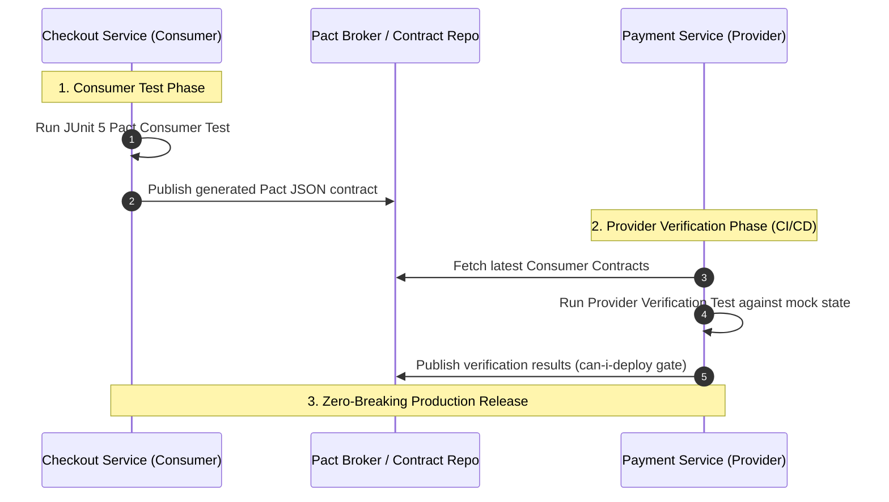

# Enterprise Microservices API Governance with Pact Contract Testing

[](https://www.oracle.com/java/)
[](https://spring.io/projects/spring-boot)
[](https://pact.io)
[](.github/workflows/ci.yml)

This reference project demonstrates **Consumer-Driven Contract Testing (CDCT)** in a cloud-native microservices ecosystem. It illustrates how decoupled engineering squads can validate HTTP/REST API contracts independently without maintaining fragile, slow, and expensive end-to-end integration test environments.

---

## 🏗️ Architectural Overview & Workflow



---

## ⚡ Key Highlights & Production Standards

- **Modern JVM Core:** Built on **Java 21 LTS** utilizing Records for immutable data models and Generational ZGC runtime tuning.
- **Consumer-Driven Design:** The consumer specifies the exact contract payload expectations (`PaymentConsumerContractTest.java`).
- **Provider Verification:** The provider verifies the contract against its active HTTP controller endpoints (`PaymentProviderVerificationTest.java`).
- **CI/CD Integration Gate (`can-i-deploy`):** Automated GitHub Actions pipeline builds the project and executes contract verification suites on every push.
- **Containerization:** Multi-stage `Dockerfile` optimizing build caching and slim JRE 21 runtime container footprint.

---

## 🚀 Running Locally

### Prerequisites
- JDK 21+
- Apache Maven 3.9+
- Docker (optional)

### Build and Run Contract Tests
```bash
# Execute unit and Pact contract verification tests
mvn clean verify
```

Generated contracts will be written to `target/pacts/CheckoutServiceConsumer-PaymentServiceProvider.json`.

---

## 👨‍💻 Author & Maintainer
**Sagar Bhirde**  
Lead Java & Cloud Engineer  
[LinkedIn](https://www.linkedin.com/in/sagar-bhirde/) | [Email](mailto:sagarbhirde111@gmail.com)
